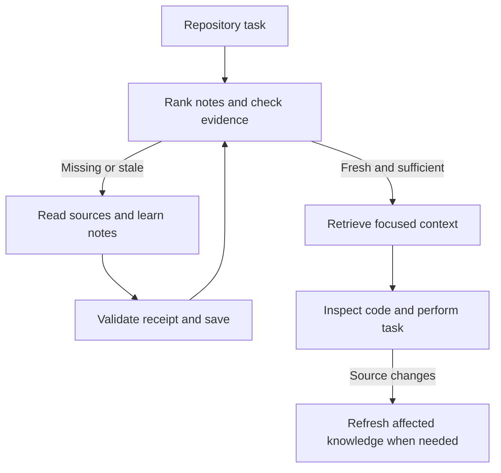

# RepoEcho

**Repository memory that knows when it needs refreshing.**

A two-pass knowledge-caching skill for **GitHub Copilot CLI**. Let Copilot learn a repository, retain compact source-linked notes, and retrieve only relevant notes whose evidence still matches. Java/Maven/Gradle guidance is included; the cache engine works with eligible text files in any language and in Git or plain directory trees.

## Install once, use across repositories

Requirements: GitHub Copilot CLI, **Python 3.10+ with the standard `sqlite3` module**, and Git for Git-aware discovery. No pip install, server, embedding model, API key or Java dependency.

```sh
git clone https://github.com/ArvinUbhi/repoecho.git
cd repoecho
python3 tools/install.py
```

On Windows use `py -3 tools/install.py` or `python tools/install.py`. The installer copies the **complete** skill to `~/.copilot/skills/repoecho`, including scripts and references. It refuses to overwrite an existing installation unless you pass `--replace`.

In Copilot CLI:

```text
/skills reload
/skills info repoecho
Use /repoecho to learn this repository's architecture, build, tests and main modules.
```

In a later session:

```text
Use /repoecho to find the process shutdown code and help me make this change: ...
```

Copilot first tries validated retrieval. It learns missing or stale parts when needed, then resumes the engineering task. Explicit `/repoecho` invocation is the most reliable way to request this workflow; automatic activation depends on Copilot selecting the skill. A skill does not install a background hook or force every prompt through a cache.

For a project-local installation:

```sh
python3 tools/install.py --project /path/to/your/java-app
```

This copies to that repository's `.github/skills/repoecho`. Commit the skill if the team should share its instructions. Generated knowledge stays local in each checkout's `.repoecho/`. A generated ignore file keeps that cache out of ordinary Git adds. For an optional instruction reminder, see [the integration snippet](docs/copilot-instructions-snippet.md).

## The two passes

**Pass one — learn/update.** Discover relevant files, read a bounded selection, have Copilot synthesize concise notes, and bind each note to the exact bytes read. Refresh only evidence affected by a change. The helper never generates or invents knowledge itself.

**Pass two — retrieve/act.** Rank notes for the current task, verify their evidence, and return a bounded set of fresh notes. Copilot then reads the necessary code, performs the task and validates its changes. A warm cache skips unnecessary relearning.



## What makes a note fresh?

| Mechanism | Purpose |
|---|---|
| SHA-256 source hashes | Detect changes to the actual working-tree bytes, including uncommitted edits |
| Scope digests | Detect additions, removals and edits across a package/module/file group |
| One-use evidence receipts | Reject a note if sources change after Copilot reads them but before it saves |
| Policy fingerprint | Invalidate when the helper, skill instructions or cache configuration change |
| UTC timestamps | Track capture, generation, verification and review expiry separately |
| Review TTL | Require review after 30 days by default, even when source hashes match |
| Root identity | Prevent accidental reuse of a copied cache from a different checkout |

Timestamps do not override hashes. Branch names and commit IDs are not the cache key: identical evidence can be reused after switching branches, while dirty files still invalidate it. Stale note bodies are withheld rather than returned with a warning.

An architectural claim can become obsolete when a new implementation is added. Bind that note to a scope such as `src/main/java/example/**`. Bind Maven module knowledge to parent/child POM evidence and, where relevant, `**/pom.xml`. Scope selection is explicit: no lexical tool can infer every semantic dependency reliably.

## Efficient retrieval

- Warm scans enumerate/stat files and reuse unchanged manifest hashes.
- Queries independently rehash only candidate evidence and its declared scopes before serving notes.
- Shared evidence is hashed once per invocation.
- SQLite FTS5/BM25 searches note text, tags, paths and identifiers; a lexical fallback supports SQLite builds without FTS5.
- Character budgets and result limits keep full repositories out of the model context.
- SQLite transactions coordinate writes; no long-running process or background indexing is required.

Initial indexing is proportional to eligible file bytes. Warm discovery still costs O(file count); broad scopes require broad verification. Savings come from reducing repeated LLM exploration and context, not from eliminating all disk reads. Benchmarks measure the local helper, not Copilot latency or token savings. See [validation and benchmark notes](docs/validation.md).

## Skill and project layout

| Path | Purpose |
|---|---|
| [.github/skills/repoecho/SKILL.md](.github/skills/repoecho/SKILL.md) | The Copilot two-pass workflow |
| [.github/skills/repoecho/scripts/repoecho.py](.github/skills/repoecho/scripts/repoecho.py) | Standard-library scanner, evidence validator, cache and retrieval CLI |
| [.github/skills/repoecho/references/cache-contract.md](.github/skills/repoecho/references/cache-contract.md) | Freshness, configuration, exclusions and recovery |
| [.github/skills/repoecho/references/note-format.md](.github/skills/repoecho/references/note-format.md) | Source-linked knowledge note schema |
| [.github/skills/repoecho/references/java.md](.github/skills/repoecho/references/java.md) | Maven, Gradle, Java 8 and monorepo guidance |
| [tools/install.py](tools/install.py) | Personal or project installation, with replacement protection |
| [tools/benchmark.py](tools/benchmark.py) | Reproducible synthetic cache benchmark |
| [tests/](tests/) | Behavioral, failure-mode and installation tests |
| [.github/workflows/test.yml](.github/workflows/test.yml) | Linux, macOS and Windows test matrix |

The `agents/openai.yaml` file is optional metadata for other compatible skill surfaces; Copilot uses `SKILL.md` and its referenced resources.

## Helper commands

For a personal installation on macOS/Linux:

```sh
REPOECHO="$HOME/.copilot/skills/repoecho/scripts/repoecho.py"
python3 "$REPOECHO" --root /path/to/app plan --query "process lifecycle"
python3 "$REPOECHO" --root /path/to/app query "ProcessManager shutdown" --limit 5
python3 "$REPOECHO" --root /path/to/app scan --full
python3 "$REPOECHO" --root /path/to/app status
python3 "$REPOECHO" --root /path/to/app forget process-lifecycle
```

`--root` precedes the command. The default is the current directory; always choose a consistent root. `status` reports candidate/stale states without loading note bodies; `query` performs authoritative content verification. For `capture` → Copilot synthesis → `remember`, follow [SKILL.md](.github/skills/repoecho/SKILL.md).

Optional `.repoecho.json` in the target repository:

```json
{
  "exclude": ["fixtures/private/**", "**/generated/**"],
  "max_file_bytes": 1048576,
  "note_ttl_days": 30,
  "full_verify_hours": 24
}
```

## Boundaries

This caches repository knowledge, not model weights, KV state, provider prompt caches, or complete past conversations. Retrieval is lexical, not embeddings-based. Correct hashes establish unchanged evidence, not correct interpretation.

The generic engine indexes bounded UTF-8 text, with exclusions for binaries, common generated/vendor directories, symlinks, oversized files and likely secret filenames. Git ignores are respected for untracked files. Plain directories use built-in exclusions and `.repoechoignore`; they do not emulate Git ignore semantics. Submodules should be indexed as separate roots. Path filters are not a general secret scanner.

No cache can infer uncaptured semantic dependencies or promise an atomic snapshot while another process edits the repository. Keep notes focused, include shared contracts/configuration, and inspect current source before edits. Exact limits and recovery behavior are documented in the [cache contract](.github/skills/repoecho/references/cache-contract.md).

## Development

```sh
python3 -m unittest discover -s tests -v
python3 tools/benchmark.py --files 2000 --runs 5
```

Copilot format and locations were checked against [GitHub's official skill guide](https://docs.github.com/en/copilot/how-tos/copilot-cli/customize-copilot/add-skills) and [CLI reference](https://docs.github.com/en/copilot/reference/copilot-cli-reference/cli-command-reference). Search uses [SQLite FTS5](https://www.sqlite.org/fts5.html) through Python's [`sqlite3`](https://docs.python.org/3/library/sqlite3.html).

Created for **Arvin Ubhi**.
