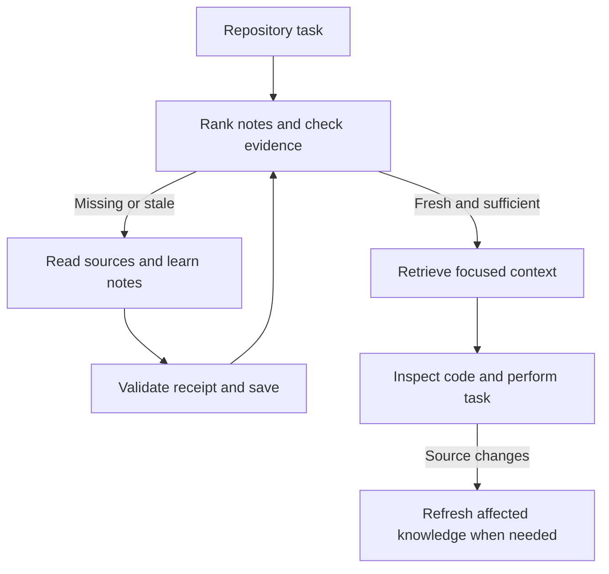

# RepoEcho

**Repository memory that knows when it needs refreshing.**

A two-pass knowledge-caching skill for **GitHub Copilot CLI**. Let Copilot learn a repository, retain compact source-linked notes, and retrieve only relevant notes whose evidence still matches. Java/Maven/Gradle guidance is included; the cache engine works with eligible text files in any language and in Git or plain directory trees.

## Two-command setup

Install [GitHub CLI](https://cli.github.com/), [uv](https://docs.astral.sh/uv/getting-started/installation/) and Git first. On Windows, Git for Windows supplies the `sh` interpreter used by gh aliases. Then:

```sh
gh repo clone ArvinUbhi/repoecho
uv run --no-project --python '>=3.10' repoecho/tools/install.py --gh
```

uv finds a compatible Python automatically and can download it if needed. No pip packages, API key, database server or Java dependency. Setup copies the complete skill into `~/.copilot/skills/repoecho` and registers **`gh repoecho`**. The alias points to the installed copy; you can remove the download checkout afterwards. Existing installations are protected: add `--replace` to update. Conflicting aliases are protected separately by `--replace-alias`.

Open Copilot CLI in your Java app (or any other repository):

```text
/skills reload
Use /repoecho to learn this repository's architecture, build and main modules.
```

Next time: `Use /repoecho to find the shutdown code and help me change it.` Copilot tries validated retrieval first, learning only missing or stale knowledge. Explicit invocation is reliable; automatic selection depends on Copilot. This skill does not intercept every prompt or install a background process.

## Daily commands

Run these from anywhere inside your repository; the CLI finds the Git worktree root automatically:

| Command | Result |
|---|---|
| `gh repoecho` or `gh repoecho status` | Fast mode/branch summary, no indexing or knowledge database access |
| `gh repoecho on` / `off` | Enable/disable the skill workflow for this repository |
| `gh repoecho cache on` / `off` | Independently allow/bypass cache reads and writes |
| `gh repoecho branch only` | Allow the current branch; default others off |
| `gh repoecho branch on` / `off` | Set an override for the current branch |
| `gh repoecho branch all` | Allow all branches and clear overrides |
| `gh repoecho branch inherit` | Remove the current branch override |
| `gh repoecho inspect` | Scan and show cache candidates/staleness |
| `gh repoecho doctor` | Show runtime, tool paths and effective controls |
| `gh repoecho benchmark` | Run an isolated synthetic performance benchmark |
| `gh repoecho --help` | Command help |

All three gates must allow caching. `on` does not silently enable a disabled cache or branch. Off modes retain notes but do not open the knowledge database. Ask Copilot naturally: **“Use /repoecho to turn caching off”** or **“Enable RepoEcho only for this branch.”** The skill and shell command use the same engine and settings.

For a different repository or an explicit subtree: `gh repoecho --root /path/to/app status`. Global options go before the command. Use `--json` for machine-readable controls: `gh repoecho --json status`. Non-Git source trees use the current directory unless `--root` is supplied. Separate repositories and linked worktrees never share indexes.

## Benchmark and updates

```sh
gh repoecho benchmark --files 2000 --notes 20 --runs 5 > benchmark.json
```

The benchmark creates a temporary Java fixture. It measures cold scanning, warm retrieval, source invalidation, disabled modes and feature-branch-to-main cache reuse. It never switches your repository's branch or changes its cache. Increase `--notes` for larger indexes; `--plain` measures non-Git mode. JSON output makes runs easy to compare. These are **local helper timings**, excluding outer gh/uv startup and model thinking time. The intended LLM benefit comes from reusing focused, verified notes instead of repeated exploration; no model speedup is claimed from synthetic measurements.

To update from a retained checkout:

```sh
git -C repoecho pull --ff-only
uv run --no-project --python '>=3.10' repoecho/tools/install.py --gh --replace
```

Then `/skills reload` in Copilot. If you removed the checkout, clone it again first. `gh repoecho setup --gh` repairs alias registration using the installed copy; it does not fetch updates.

For a project/team installation: `gh repoecho setup --project /path/to/app` (add `--replace` when updating). The personal gh command continues to use the personal skill version. Keep versions aligned when using both. Without gh, omit `--gh` during setup and use Copilot or the bundled CLI directly. Without uv, Python 3.10+ with `sqlite3` can execute the same scripts. Offline machines need a compatible Python already available; set `UV_OFFLINE=1` to prevent downloads.

This uses GitHub's supported **shell alias** mechanism, not a gh extension. Remove the alias with `gh alias delete repoecho`. Full setup and controls live in the skill's [setup reference](.github/skills/repoecho/references/setup.md) and [mode reference](.github/skills/repoecho/references/controls.md). To toggle Copilot's global skill discovery itself, use `copilot skill disable repoecho` / `copilot skill enable repoecho`; repository controls remain independent.

## The two passes

**Pass one — learn/update.** Discover relevant files, read a bounded selection, have Copilot synthesize concise notes, and bind each note to the exact bytes read. Refresh only evidence affected by a change. The helper never generates or invents knowledge itself.

**Pass two — retrieve/act.** Rank notes for the current task, verify their evidence, and return a bounded set of fresh notes. Copilot then reads the necessary code, performs the task and validates its changes. A warm cache skips unnecessary relearning.



## What makes a note fresh?

| Mechanism | Purpose |
|---|---|
| SHA-256 source hashes | Detect changes to the actual working-tree bytes, including uncommitted edits |
| Scope digests | Detect additions, removals and edits across a package/module/file group |
| One-use evidence receipts | Reject a note if sources change after Copilot reads them but before it saves |
| Policy fingerprint | Invalidate when the helper, skill instructions or cache configuration change |
| UTC timestamps | Track capture, generation, verification and review expiry separately |
| Review TTL | Require review after 30 days by default, even when source hashes match |
| Root identity | Prevent accidental reuse of a copied cache from a different checkout |

Timestamps do not override hashes. Branch names and commit IDs are not the cache key: identical evidence can be reused after switching branches, while dirty files still invalidate it. Stale note bodies are withheld rather than returned with a warning.

Git works in the background through `branch` identity, `status`, staged/unstaged `diff`, and a diff between the previous and current scanned commits. These provide incremental change hints; hashes remain authoritative. A lost/re-written previous commit triggers a full hash scan. No fetch, branch switch or Git configuration change is performed by indexing.

Different evidence versions of the same note are retained (eight by default). Learn a feature branch, return to main, and the matching main revision can be reused without learning it again. Each repository and linked worktree owns a separate database, index, receipt store and mode settings. Copied caches are rejected by root identity. See [Git tracking and isolation](.github/skills/repoecho/references/git-tracking.md).

An architectural claim can become obsolete when a new implementation is added. Bind that note to a scope such as `src/main/java/example/**`. Bind Maven module knowledge to parent/child POM evidence and, where relevant, `**/pom.xml`. Scope selection is explicit: no lexical tool can infer every semantic dependency reliably.

## Efficient retrieval

- Warm scans enumerate/stat files and reuse unchanged manifest hashes.
- Queries independently rehash only candidate evidence and its declared scopes before serving notes.
- Shared evidence is hashed once per invocation.
- SQLite FTS5/BM25 searches note text, tags, paths and identifiers; a lexical fallback supports SQLite builds without FTS5.
- Character budgets and result limits keep full repositories out of the model context.
- SQLite transactions coordinate writes; no long-running process or background indexing is required.

Initial indexing is proportional to eligible file bytes. Warm discovery still costs O(file count); broad scopes require broad verification. Savings come from reducing repeated LLM exploration and context, not from eliminating all disk reads. Benchmarks measure the local helper, not Copilot latency or token savings. See [validation and benchmark notes](docs/validation.md).

## Skill and project layout

| Path | Purpose |
|---|---|
| [.github/skills/repoecho/SKILL.md](.github/skills/repoecho/SKILL.md) | The Copilot two-pass workflow |
| [.github/skills/repoecho/scripts/repoecho.py](.github/skills/repoecho/scripts/repoecho.py) | Standard-library scanner, evidence validator, cache and retrieval engine |
| [.github/skills/repoecho/references/cache-contract.md](.github/skills/repoecho/references/cache-contract.md) | Freshness, configuration, exclusions and recovery |
| [.github/skills/repoecho/references/note-format.md](.github/skills/repoecho/references/note-format.md) | Source-linked knowledge note schema |
| [.github/skills/repoecho/references/java.md](.github/skills/repoecho/references/java.md) | Maven, Gradle, Java 8 and monorepo guidance |
| [.github/skills/repoecho/references/controls.md](.github/skills/repoecho/references/controls.md) | Skill/cache/branch modes and precedence |
| [.github/skills/repoecho/references/git-tracking.md](.github/skills/repoecho/references/git-tracking.md) | Git changes, note revisions and repository isolation |
| [tools/install.py](tools/install.py) | Personal or project installation, with replacement protection |
| [tools/benchmark.py](tools/benchmark.py) | Reproducible synthetic cache benchmark |
| [tests/](tests/) | Behavioral, failure-mode and installation tests |
| [.github/workflows/test.yml](.github/workflows/test.yml) | Linux, macOS and Windows test matrix |

The `agents/openai.yaml` file is optional metadata for other compatible skill surfaces; Copilot uses `SKILL.md` and its referenced resources.

## Helper commands

```sh
gh repoecho --root /path/to/app plan --query "process lifecycle"
gh repoecho --root /path/to/app query "ProcessManager shutdown" --limit 5
gh repoecho --root /path/to/app scan --full
gh repoecho --root /path/to/app forget process-lifecycle
```

`scan --full` refreshes hashes; Copilot must still synthesize refreshed notes. `inspect` reports candidates; `query` authoritatively validates evidence. `capture` → Copilot synthesis → `remember` is documented in [SKILL.md](.github/skills/repoecho/SKILL.md). The legacy engine script defaults to the current directory; the friendly CLI discovers the worktree root.

Optional `.repoecho.json` in the target repository:

```json
{
  "exclude": ["fixtures/private/**", "**/generated/**"],
  "max_file_bytes": 1048576,
  "note_ttl_days": 30,
  "full_verify_hours": 24,
  "max_note_versions": 8
}
```

## Boundaries

This caches repository knowledge, not model weights, KV state, provider prompt caches, or complete past conversations. Retrieval is lexical, not embeddings-based. Correct hashes establish unchanged evidence, not correct interpretation.

The generic engine indexes bounded UTF-8 text, with exclusions for binaries, common generated/vendor directories, symlinks, oversized files and likely secret filenames. Git ignores are respected for untracked files. Plain directories use built-in exclusions and `.repoechoignore`; they do not emulate Git ignore semantics. Submodules should be indexed as separate roots. Path filters are not a general secret scanner.

No cache can infer uncaptured semantic dependencies or promise an atomic snapshot while another process edits the repository. Keep notes focused, include shared contracts/configuration, and inspect current source before edits. Exact limits and recovery behavior are documented in the [cache contract](.github/skills/repoecho/references/cache-contract.md).

## Development

```sh
python3 -m unittest discover -s tests -v
uv run --no-project --python '>=3.10' tools/benchmark.py --files 2000 --notes 20 --runs 5
```

Copilot format and locations were checked against [GitHub's official skill guide](https://docs.github.com/en/copilot/how-tos/copilot-cli/customize-copilot/add-skills) and [CLI reference](https://docs.github.com/en/copilot/reference/copilot-cli-reference/cli-command-reference). Search uses [SQLite FTS5](https://www.sqlite.org/fts5.html) through Python's [`sqlite3`](https://docs.python.org/3/library/sqlite3.html).

Created for **Arvin Ubhi**.
